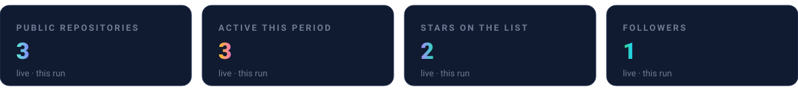
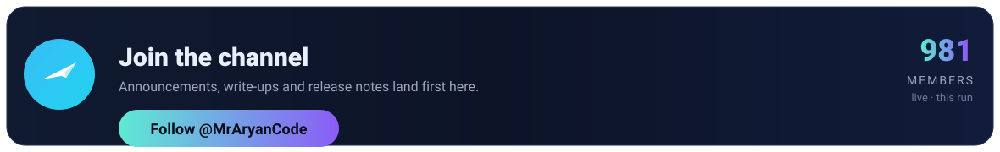

<!--profile-face:v1
tokens: cli, design, devops, gateway, mraryancode, open-source
numbers: repositories=3, active_projects=3, listed_projects=3, stars=2, followers=1, telegram_members=981, stars_certway=2, days_certway=2, stars_MrAryanCode=0, days_MrAryanCode=0, stars_MrAryanCode.github.io=0, days_MrAryanCode.github.io=0
projects: MrAryanCode/certway, MrAryanCode/MrAryanCode, MrAryanCode/MrAryanCode.github.io
-->

  

<!--profile-face:account-scope -->

MrAryanCode is a collection of small, self-contained open-source projects. 3 public repositories, 3 of them touched in the active window. Each is maintained on its own, with its own issue tracker and its own release stream, and there is no shared runtime to install across them.

## In numbers

## Follow along

Every project keeps its own issue tracker; the fastest way to reach the account is
to open an issue on the project it concerns.

  <b>MrAryanCode</b> · last updated 2026-11-06

