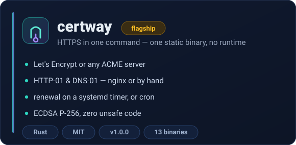
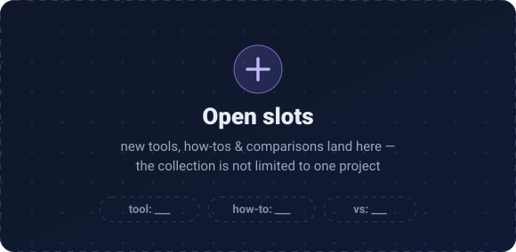

<div align="center">
  
  <br><br>
  
  <br><br>
  <a href="https://github.com/GatewayIRAN/certway/releases"></a>
  <a href="https://github.com/GatewayIRAN/certway/blob/main/LICENSE"></a>
  <a href="https://github.com/GatewayIRAN/certway/actions/workflows/release.yml"></a>
  
  
  
  <br><br>
  <b>GatewayIRAN is a hub — open tools, how-tos and comparisons for real boxes.</b><br>
  <sub><b>certway</b> is the flagship of the collection, not the whole story;<br>anything worth shipping lands in this repository family.</sub>
</div>


## The collection

<table>
<tr>
<td width="50%"></td>
<td width="50%"></td>
</tr>
</table>

**certway** — HTTPS in one command. One static binary, no daemon, no Python,
no OpenSSL on the box:

```bash
curl --proto '=https' --tlsv1.2 -sSfL https://github.com/GatewayIRAN/certway/releases/latest/download/certway-installer.sh | sh
```

`certway issue example.com` walks the authority for you and writes
`certs/fullchain.pem` + `certs/privkey.pem`, then `certway install` sets up
renewal (systemd timer, or cron where systemd is absent). Where certbot is a
Swiss army knife of plugins, certway is two crates that do one job: ECDSA P-256
certificates over HTTP-01/DNS-01, for nginx or by hand, with refusal instead of
guessing when an nginx edit is ambiguous.

[github.com/GatewayIRAN/certway](https://github.com/GatewayIRAN/certway) —
MIT licensed, built on `ring` and `rustls`, zero unsafe code.
Reacts to every nginx config change and reloads it for you.

The next tools, how-tos and comparisons arrive in the same shape: one problem,
one small static binary, no configuration to babysit — keep an eye on the
[channel](https://t.me/GatewayIRAN) and the
[releases feed](https://github.com/GatewayIRAN/certway/releases).


## In numbers


## Join the channel

<div align="center">
  
  <br><br>
  <a href="https://t.me/GatewayIRAN"></a>
  <br>
  <sub>Releases, how-tos and comparisons are announced on the channel — in Persian.<br>
  «به کانال تلگرام <a href="https://t.me/GatewayIRAN">GatewayIRAN</a> بپیوندید.»</sub>
</div>

## Security and license

- 🕵️ Something looks off in a release? [Report a vulnerability privately →](https://github.com/GatewayIRAN/certway/security/advisories/new) — do not open a public issue.
- 🤝 Want to help the collection grow? [CONTRIBUTING.md →](https://github.com/GatewayIRAN/certway/blob/main/CONTRIBUTING.md)
- 📦 [Release notes →](https://github.com/GatewayIRAN/certway/releases)
- ©️ MIT — free to use, free to fork.


<div align="center">
  <sub><b>GATEWAYIRAN</b> · open tools, how-tos &amp; comparisons · <a href="https://t.me/GatewayIRAN">t.me/GatewayIRAN</a> · <a href="https://gatewayiran.github.io">gatewayiran.github.io</a></sub>
</div>
